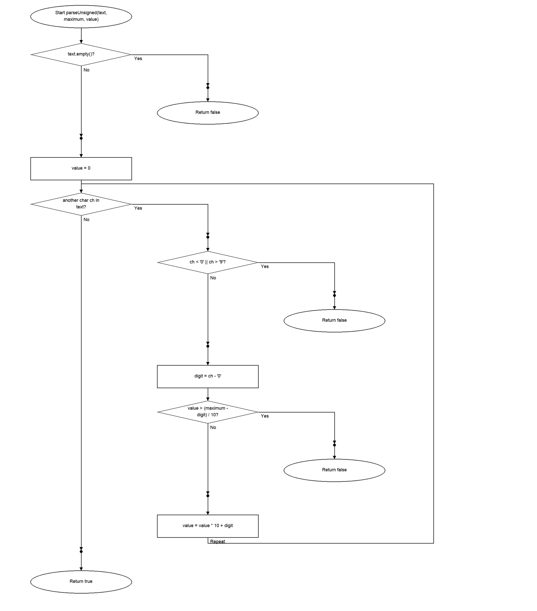

# T01 – parseUnsigned(text, maximum, value)

Input: text, maximum, value.

Output: bool; updates value.



[Editable diagram](T01-parseUnsigned.drawio)

Pseudocode:

```text
START parseUnsigned(text, maximum, value)
    IF text.empty() THEN
        RETURN false
    END IF
    value = 0
    WHILE another char ch in text
        IF ch < '0' || ch > '9' THEN
            RETURN false
        END IF
        digit = ch - '0'
        IF value > (maximum - digit) / 10 THEN
            RETURN false
        END IF
        value = value * 10 + digit
    END WHILE
    RETURN true
END
```

Integer `/` means integer division for integer operands. Skipping a record continues the current loop.
