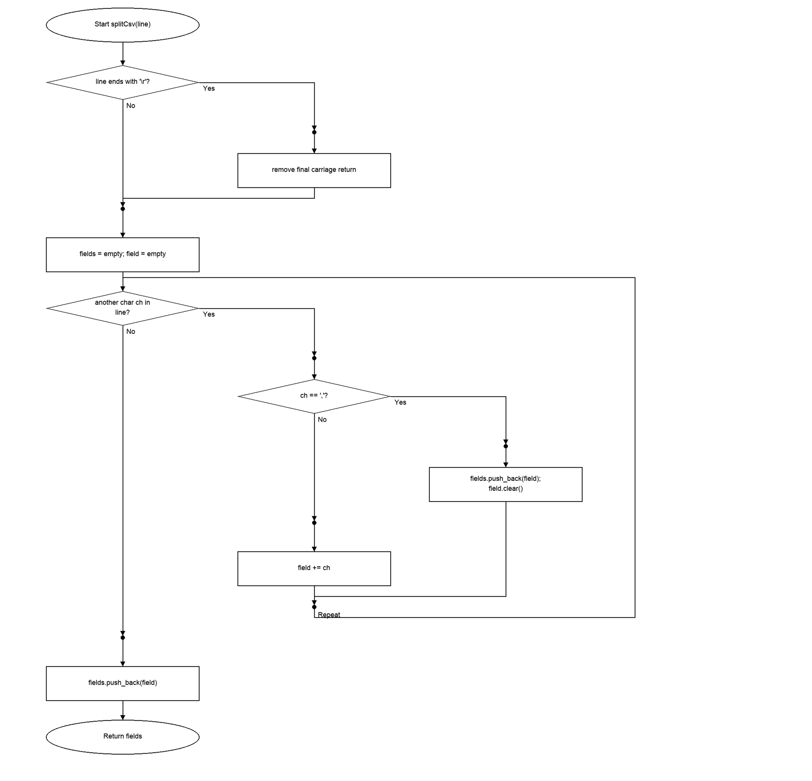

# T01 – splitCsv(line)

Input: line.

Output: vector<string> fields.



[Editable diagram](T01-splitCsv.drawio)

Pseudocode:

```text
START splitCsv(line)
    IF line ends with '\r' THEN
        remove final carriage return
    END IF
    fields = empty; field = empty
    WHILE another char ch in line
        IF ch == ',' THEN
            fields.push_back(field); field.clear()
        ELSE
            field += ch
        END IF
    END WHILE
    fields.push_back(field)
    RETURN fields
END
```

Integer `/` means integer division for integer operands. Skipping a record continues the current loop.
