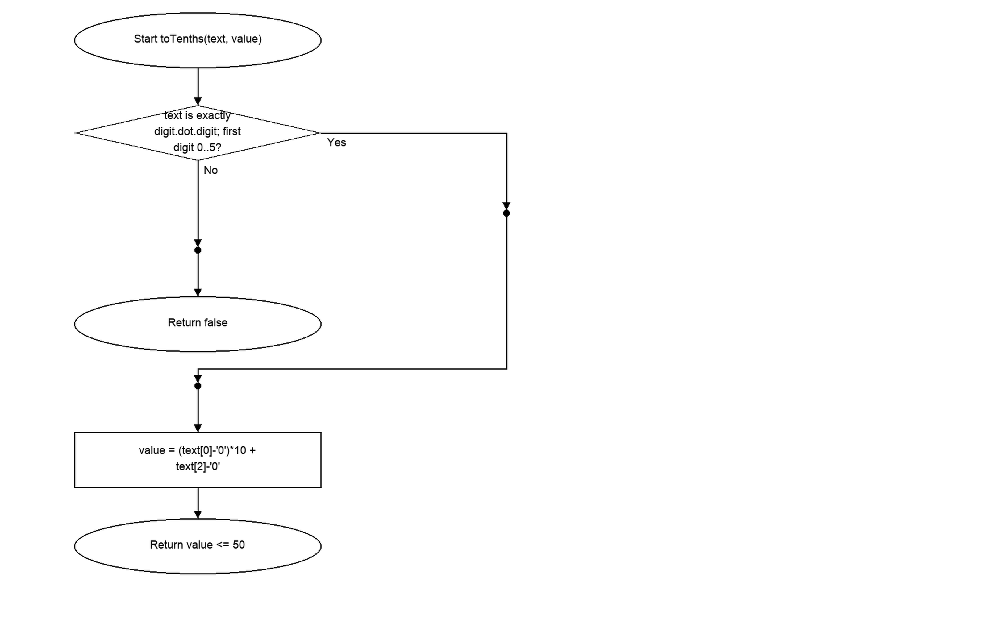

# T01 – toTenths(text, value)

Input: text, value.

Output: bool; rating stored in tenths.



[Editable diagram](T01-toTenths.drawio)

Pseudocode:

```text
START toTenths(text, value)
    IF text is exactly digit.dot.digit; first digit 0..5 THEN
    ELSE
        RETURN false
    END IF
    value = (text[0]-'0')*10 + text[2]-'0'
    RETURN value <= 50
END
```

Integer `/` means integer division for integer operands. Skipping a record continues the current loop.
