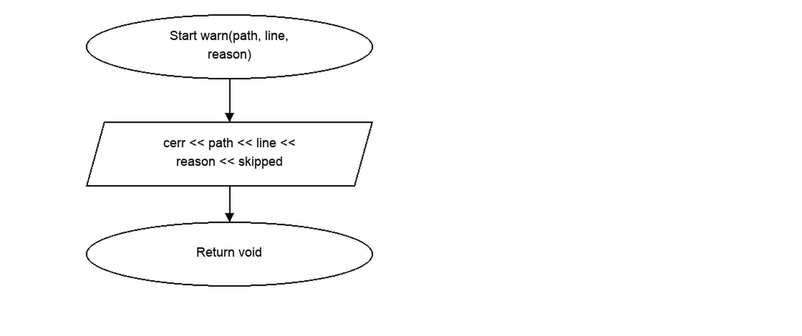

# T01 – warn(path, line, reason)

Input: path, line, reason.

Output: warning on cerr.



[Editable diagram](T01-warn.drawio)

Pseudocode:

```text
START warn(path, line, reason)
    cerr << path << line << reason << skipped
    RETURN void
END
```

Integer `/` means integer division for integer operands. Skipping a record continues the current loop.
