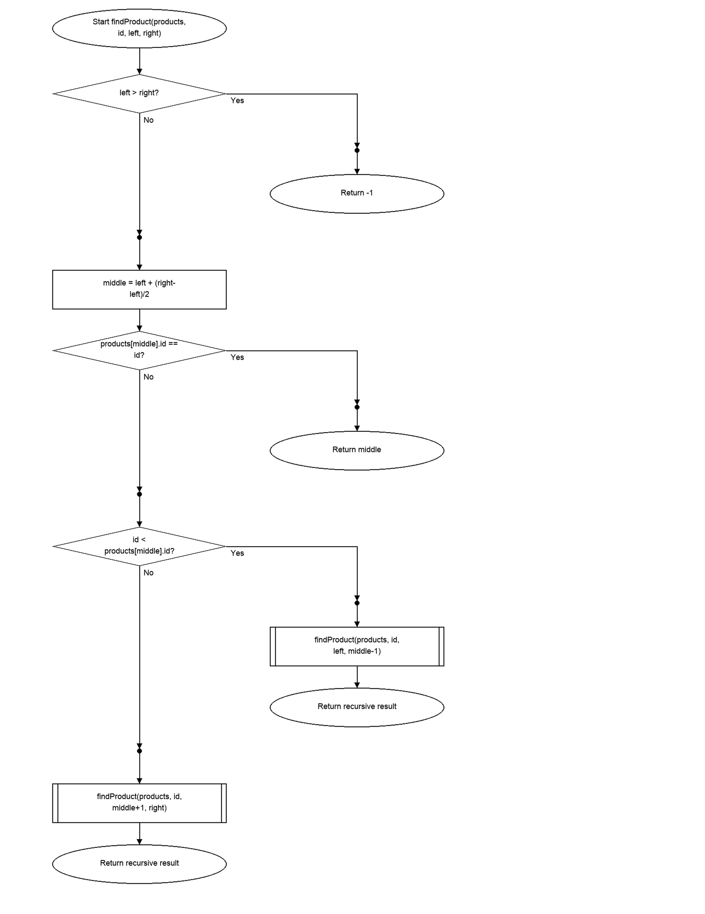

# T04 – findProduct(products, id, left, right)

Input: products, id, left, right.

Output: index or -1; products sorted by id.



[Editable diagram](T04-findProduct.drawio)

Pseudocode:

```text
START findProduct(products, id, left, right)
    IF left > right THEN
        RETURN -1
    END IF
    middle = left + (right-left)/2
    IF products[middle].id == id THEN
        RETURN middle
    END IF
    IF id < products[middle].id THEN
        CALL findProduct(products, id, left, middle-1)
        RETURN recursive result
    ELSE
        CALL findProduct(products, id, middle+1, right)
        RETURN recursive result
    END IF
END
```

Integer `/` means integer division for integer operands. Skipping a record continues the current loop.
