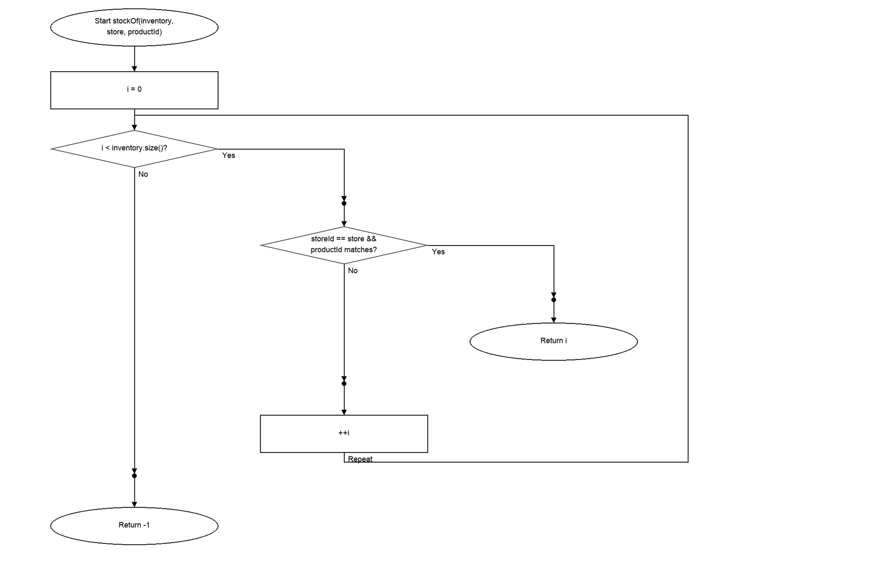

# T04 – stockOf(inventory, store, productId)

Input: inventory, store, productId.

Output: record index or -1.



[Editable diagram](T04-stockOf.drawio)

Pseudocode:

```text
START stockOf(inventory, store, productId)
    i = 0
    WHILE i < inventory.size()
        IF storeId == store && productId matches THEN
            RETURN i
        END IF
        ++i
    END WHILE
    RETURN -1
END
```

Integer `/` means integer division for integer operands. Skipping a record continues the current loop.
