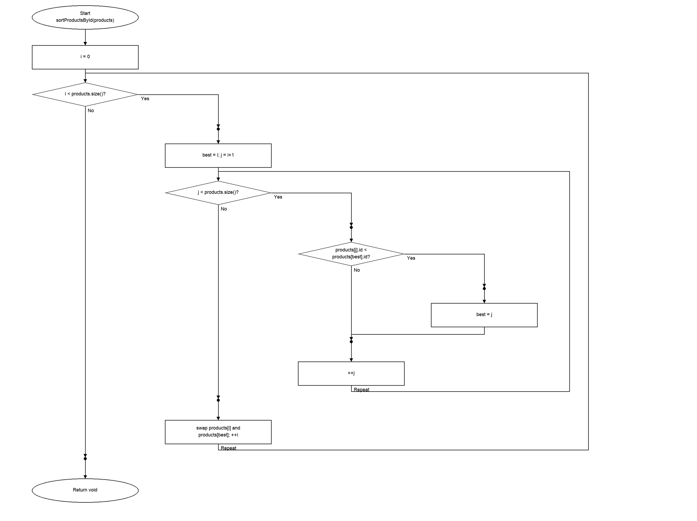

# T05 – sortProductsById(products)

Input: products.

Output: products sorted by id ascending.



[Editable diagram](T05-sortProductsById.drawio)

Pseudocode:

```text
START sortProductsById(products)
    i = 0
    WHILE i < products.size()
        best = i; j = i+1
        WHILE j < products.size()
            IF products[j].id < products[best].id THEN
                best = j
            END IF
            ++j
        END WHILE
        swap products[i] and products[best]; ++i
    END WHILE
    RETURN void
END
```

Integer `/` means integer division for integer operands. Skipping a record continues the current loop.
