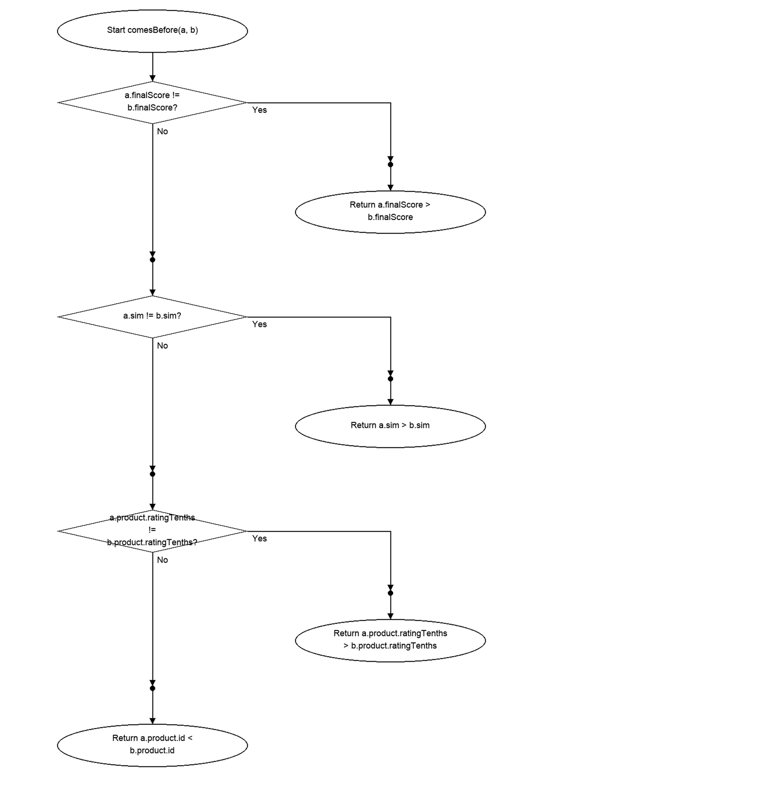

# T06 – comesBefore(a, b)

Input: a, b.

Output: bool; strict ranking order.



[Editable diagram](T06-comesBefore.drawio)

Pseudocode:

```text
START comesBefore(a, b)
    IF a.finalScore != b.finalScore THEN
        RETURN a.finalScore > b.finalScore
    END IF
    IF a.sim != b.sim THEN
        RETURN a.sim > b.sim
    END IF
    IF a.product.ratingTenths != b.product.ratingTenths THEN
        RETURN a.product.ratingTenths > b.product.ratingTenths
    END IF
    RETURN a.product.id < b.product.id
END
```

Integer `/` means integer division for integer operands. Skipping a record continues the current loop.
