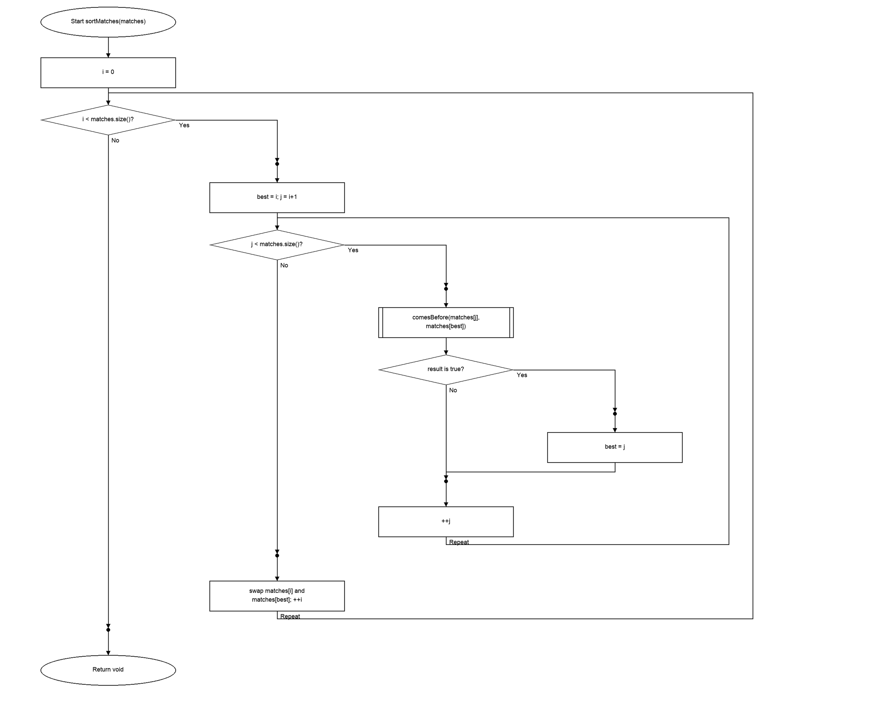

# T06 – sortMatches(matches)

Input: matches.

Output: matches sorted using comesBefore.



[Editable diagram](T06-sortMatches.drawio)

Pseudocode:

```text
START sortMatches(matches)
    i = 0
    WHILE i < matches.size()
        best = i; j = i+1
        WHILE j < matches.size()
            CALL comesBefore(matches[j], matches[best])
            IF result is true THEN
                best = j
            END IF
            ++j
        END WHILE
        swap matches[i] and matches[best]; ++i
    END WHILE
    RETURN void
END
```

Integer `/` means integer division for integer operands. Skipping a record continues the current loop.
