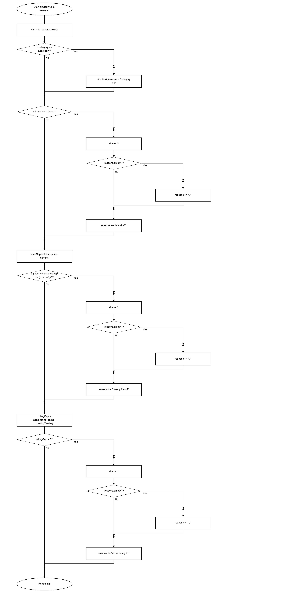

# T07 – similarity(q, c, reasons)

Input: q, c, reasons.

Output: sim 0..10; reasons updated by reference.



[Editable diagram](T07-similarity.drawio)

Pseudocode:

```text
START similarity(q, c, reasons)
    sim = 0; reasons.clear()
    IF c.category == q.category THEN
        sim += 4; reasons = "category +4"
    END IF
    IF c.brand == q.brand THEN
        sim += 3
        IF !reasons.empty() THEN
            reasons += ", "
        END IF
        reasons += "brand +3"
    END IF
    priceGap = llabs(c.price - q.price)
    IF q.price > 0 && priceGap <= (q.price-1)/5 THEN
        sim += 2
        IF !reasons.empty() THEN
            reasons += ", "
        END IF
        reasons += "close price +2"
    END IF
    ratingGap = abs(c.ratingTenths - q.ratingTenths)
    IF ratingGap < 3 THEN
        sim += 1
        IF !reasons.empty() THEN
            reasons += ", "
        END IF
        reasons += "close rating +1"
    END IF
    RETURN sim
END
```

Integer `/` means integer division for integer operands. Skipping a record continues the current loop.

The four criteria are independent. The price predicate implements a strict difference below 20% without multiplication overflow. With q.price=0 it earns no price points.
