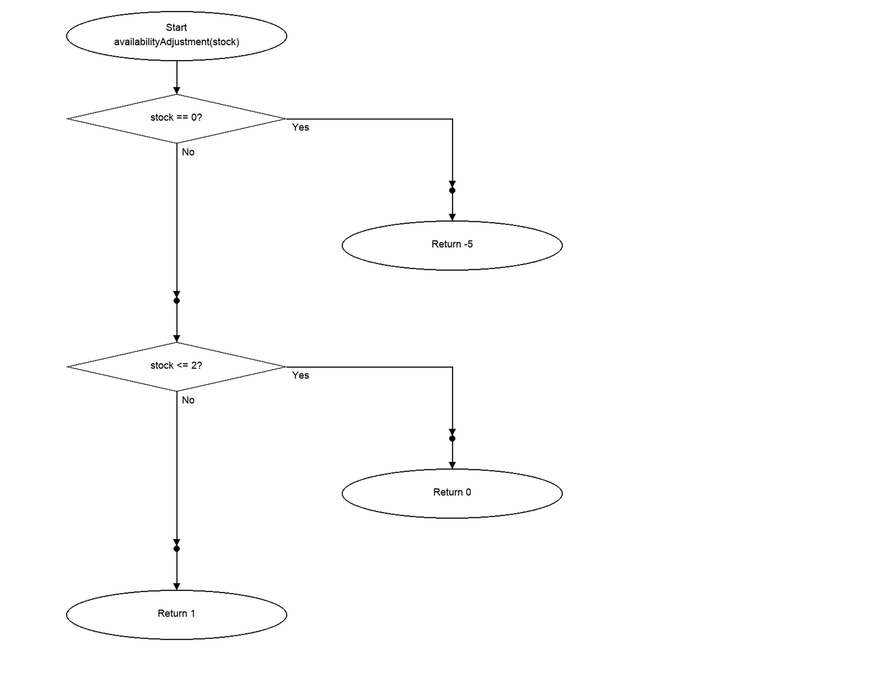

# T08 – availabilityAdjustment(stock)

Input: stock.

Output: adjustment -5, 0, or 1.



[Editable diagram](T08-availabilityAdjustment.drawio)

Pseudocode:

```text
START availabilityAdjustment(stock)
    IF stock == 0 THEN
        RETURN -5
    END IF
    IF stock <= 2 THEN
        RETURN 0
    END IF
    RETURN 1
END
```

Integer `/` means integer division for integer operands. Skipping a record continues the current loop.
