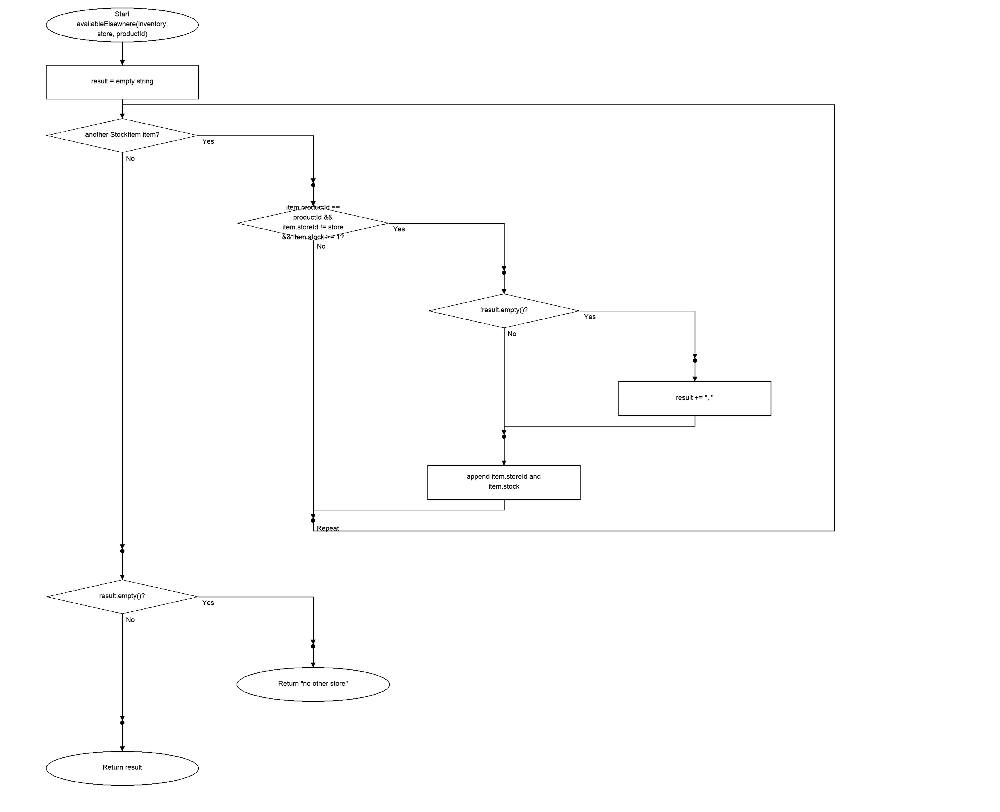

# T08 – availableElsewhere(inventory, store, productId)

Input: inventory, store, productId.

Output: text naming other available stores.



[Editable diagram](T08-availableElsewhere.drawio)

Pseudocode:

```text
START availableElsewhere(inventory, store, productId)
    result = empty string
    WHILE another StockItem item
        IF item.productId == productId && item.storeId != store && item.stock >= 1 THEN
            IF !result.empty() THEN
                result += ", "
            END IF
            append item.storeId and item.stock
        END IF
    END WHILE
    IF result.empty() THEN
        RETURN "no other store"
    END IF
    RETURN result
END
```

Integer `/` means integer division for integer operands. Skipping a record continues the current loop.
