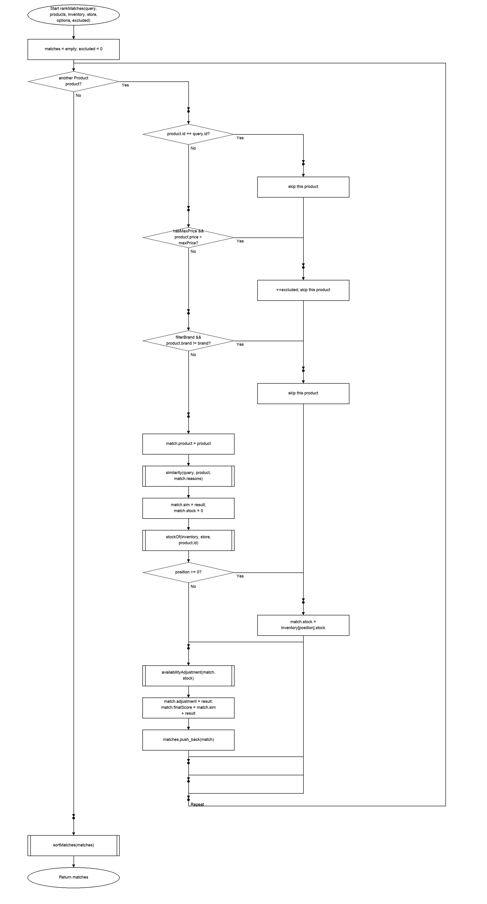

# T09 – rankMatches(query, products, inventory, store, options, excluded)

Input: query, products, inventory, store, options, excluded.

Output: ranked matches; excluded updated.



[Editable diagram](T09-rankMatches.drawio)

Pseudocode:

```text
START rankMatches(query, products, inventory, store, options, excluded)
    matches = empty; excluded = 0
    WHILE another Product product
        IF product.id == query.id THEN
            skip this product
        ELSE
            IF hasMaxPrice && product.price > maxPrice THEN
                ++excluded; skip this product
            ELSE
                IF filterBrand && product.brand != brand THEN
                    skip this product
                ELSE
                    match.product = product
                    CALL similarity(query, product, match.reasons)
                    match.sim = result; match.stock = 0
                    CALL stockOf(inventory, store, product.id)
                    IF position >= 0 THEN
                        match.stock = inventory[position].stock
                    END IF
                    CALL availabilityAdjustment(match.stock)
                    match.adjustment = result; match.finalScore = match.sim + result
                    matches.push_back(match)
                END IF
            END IF
        END IF
    END WHILE
    CALL sortMatches(matches)
    RETURN matches
END
```

Integer `/` means integer division for integer operands. Skipping a record continues the current loop.
