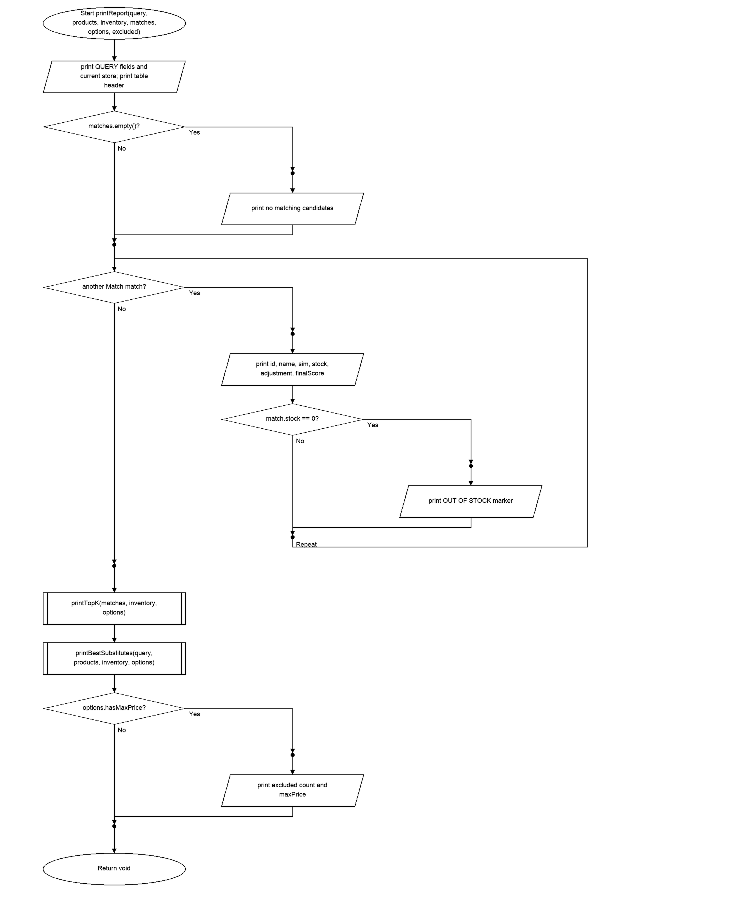

# T10 – printReport(query, products, inventory, matches, options, excluded)

Input: query, products, inventory, matches, options, excluded.

Output: complete console report.



[Editable diagram](T10-printReport.drawio)

Pseudocode:

```text
START printReport(query, products, inventory, matches, options, excluded)
    print QUERY fields and current store; print table header
    IF matches.empty() THEN
        print no matching candidates
    END IF
    WHILE another Match match
        print id, name, sim, stock, adjustment, finalScore
        IF match.stock == 0 THEN
            print OUT OF STOCK marker
        END IF
    END WHILE
    CALL printTopK(matches, inventory, options)
    CALL printBestSubstitutes(query, products, inventory, options)
    IF options.hasMaxPrice THEN
        print excluded count and maxPrice
    END IF
    RETURN void
END
```

Integer `/` means integer division for integer operands. Skipping a record continues the current loop.
