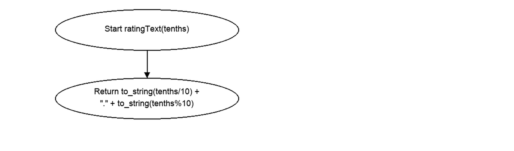

# T10 – ratingText(tenths)

Input: tenths.

Output: rating formatted with one decimal digit.



[Editable diagram](T10-ratingText.drawio)

Pseudocode:

```text
START ratingText(tenths)
    RETURN to_string(tenths/10) + "." + to_string(tenths%10)
END
```

Integer `/` means integer division for integer operands. Skipping a record continues the current loop.
