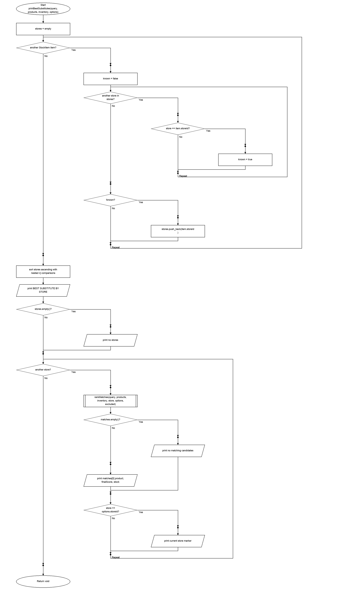

# T12 – printBestSubstitutes(query, products, inventory, options)

Input: query, products, inventory, options.

Output: winner for every known valid store.



[Editable diagram](T12-printBestSubstitutes.drawio)

Pseudocode:

```text
START printBestSubstitutes(query, products, inventory, options)
    stores = empty
    WHILE another StockItem item
        known = false
        WHILE another store in stores
            IF store == item.storeId THEN
                known = true
            END IF
        END WHILE
        IF !known THEN
            stores.push_back(item.storeId)
        END IF
    END WHILE
    sort stores ascending with nested i/j comparisons
    print BEST SUBSTITUTE BY STORE
    IF stores.empty() THEN
        print no stores
    END IF
    WHILE another store
        CALL rankMatches(query, products, inventory, store, options, excluded)
        IF matches.empty() THEN
            print no matching candidates
        ELSE
            print matches[0] product, finalScore, stock
        END IF
        IF store == options.storeId THEN
            print current store marker
        END IF
    END WHILE
    RETURN void
END
```

Integer `/` means integer division for integer operands. Skipping a record continues the current loop.
