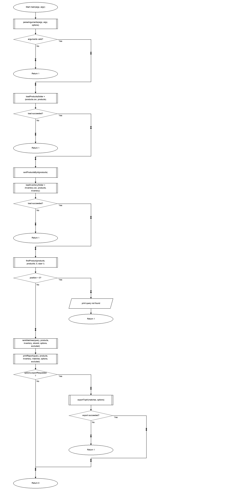

# T13 – main(argc, argv)

Input: argc, argv.

Output: exit 0 success, exit 1 error.



[Editable diagram](T13-main.drawio)

Pseudocode:

```text
START main(argc, argv)
    CALL parseArguments(argc, argv, options)
    IF arguments valid THEN
    ELSE
        RETURN 1
    END IF
    CALL loadProducts(folder + /products.csv, products)
    IF load succeeded THEN
    ELSE
        RETURN 1
    END IF
    CALL sortProductsById(products)
    CALL loadInventory(folder + /inventory.csv, products, inventory)
    IF load succeeded THEN
    ELSE
        RETURN 1
    END IF
    CALL findProduct(products, productId, 0, size-1)
    IF position < 0 THEN
        print query not found
        RETURN 1
    END IF
    CALL rankMatches(query, products, inventory, storeId, options, excluded)
    CALL printReport(query, products, inventory, matches, options, excluded)
    IF options.exportRequested THEN
        CALL exportTopK(matches, options)
        IF export succeeded THEN
        ELSE
            RETURN 1
        END IF
    END IF
    RETURN 0
END
```

Integer `/` means integer division for integer operands. Skipping a record continues the current loop.
