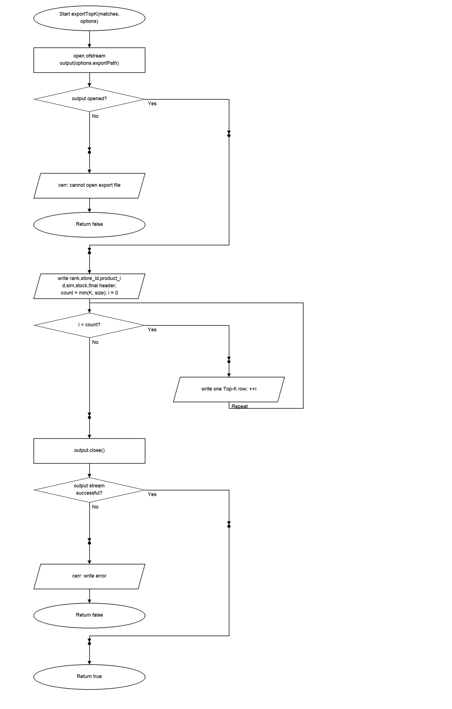

# T14 – exportTopK(matches, options)

Input: matches, options.

Output: bool; CSV output or clear error.



[Editable diagram](T14-exportTopK.drawio)

Pseudocode:

```text
START exportTopK(matches, options)
    open ofstream output(options.exportPath)
    IF output opened THEN
    ELSE
        cerr: cannot open export file
        RETURN false
    END IF
    write rank,store_id,product_id,sim,stock,final header; count = min(K, size); i = 0
    WHILE i < count
        write one Top-K row; ++i
    END WHILE
    output.close()
    IF output stream successful THEN
    ELSE
        cerr: write error
        RETURN false
    END IF
    RETURN true
END
```

Integer `/` means integer division for integer operands. Skipping a record continues the current loop.
